# CampusCare – Student Task & Notice Manager

## 1. Project Introduction and Objective
CampusCare is a simple student productivity website developed for the DevOps and Kubernetes ISE-2 practical. It allows students to add academic tasks, set deadlines, search tasks, mark tasks complete, delete tasks, and read campus notices.

## 2. Objective
- Build a useful website using HTML, CSS and JavaScript.
- Maintain the source code using Git and GitHub.
- Demonstrate meaningful version history through at least five commits.
- Integrate Jenkins as the DevOps CI tool.
- Maintain evidence through screenshots of the website, Git/GitHub history and Jenkins results.

## 3. Technology Stack
- HTML5
- CSS3
- JavaScript
- Browser LocalStorage
- Git
- GitHub
- Jenkins

## 4. How to Run
1. Download/clone the repository.
2. Open `index.html` in a browser, or use VS Code Live Server.
3. Add tasks and test Complete/Delete/Search.
4. Data is stored in browser LocalStorage.

## 5. Git/GitHub Workflow
The project was created locally, initialized with Git, committed with meaningful changes, connected to GitHub and pushed to the `main` branch.

Suggested commit history:
1. `Initial CampusCare website`
2. `Add task manager form and task cards`
3. `Add search, complete and delete features`
4. `Add campus notices and responsive design`
5. `Add LocalStorage and contact form`
6. `Integrate Jenkins CI verification`

## 6. DevOps Tool Integration – Jenkins
Jenkins is configured as a Freestyle project connected to the GitHub repository. Jenkins checks out the `main` branch and executes a Windows batch build step that verifies the required website file exists and prints a successful build message.

Build commands:
```
if not exist index.html exit /b 1
echo CampusCare CI build started
echo Website source file verified successfully
echo CampusCare Jenkins build completed successfully
```

## 7. Evidence
Include screenshots of:
- Working CampusCare website
- Git status and commit history
- GitHub repository with files
- At least five meaningful commits
- Jenkins job configuration showing GitHub repository and main branch
- Jenkins console output showing `Finished: SUCCESS`
- Jenkins build history
- GitHub webhook delivery, if webhook triggering is configured

# CampusCare Project Screenshots

## Screenshot 1.1
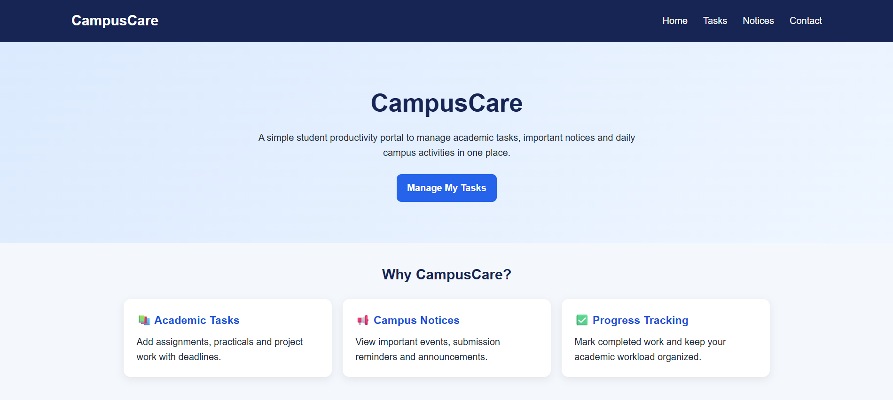

## Screenshot 2.1
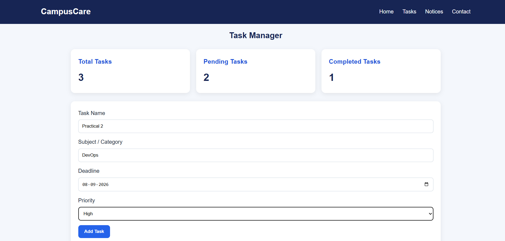

## Screenshot 2.2
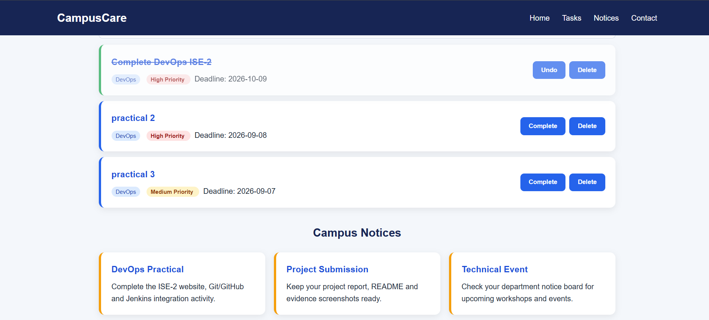

## Screenshot 3.1
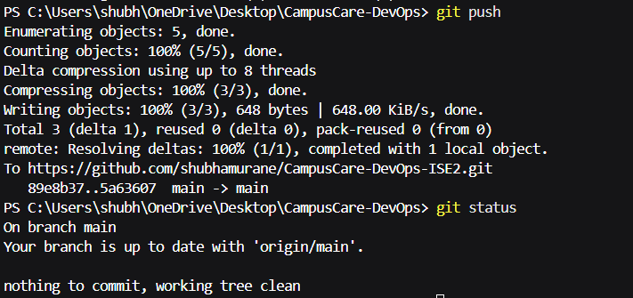

## Screenshot 4.1
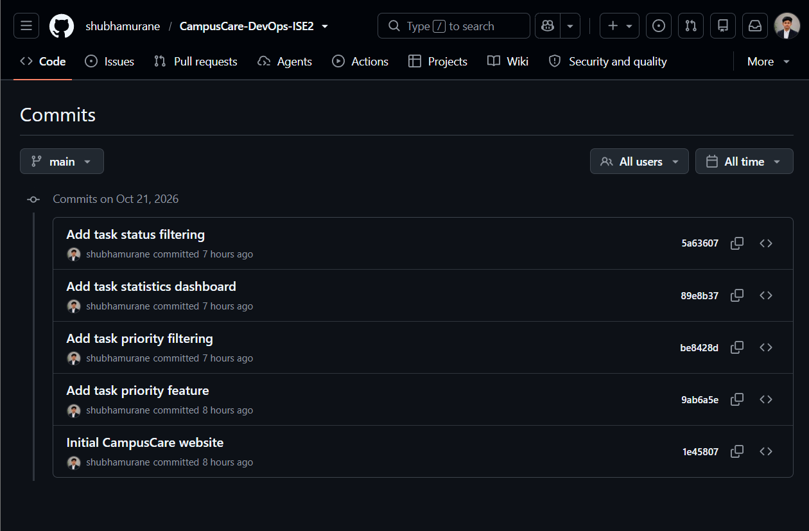

## Screenshot 5.1
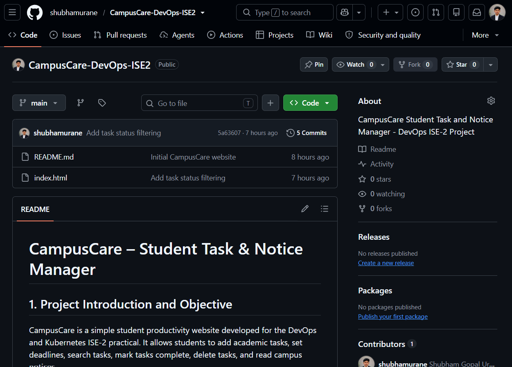

## Screenshot 6.1
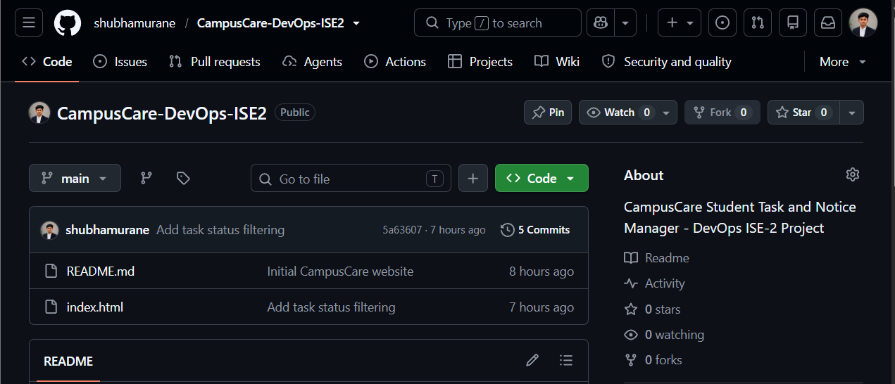

## Screenshot 7.1
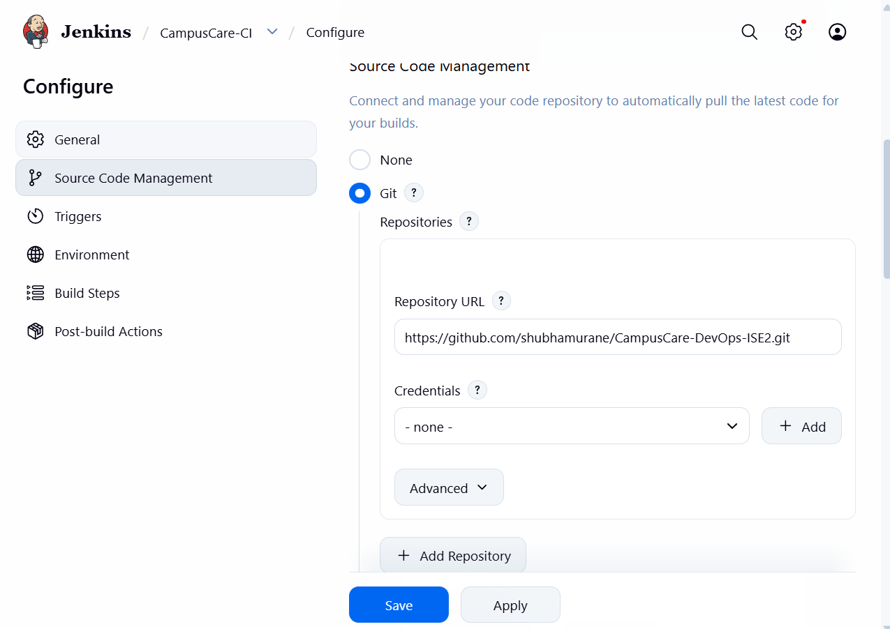

## Screenshot 7.2
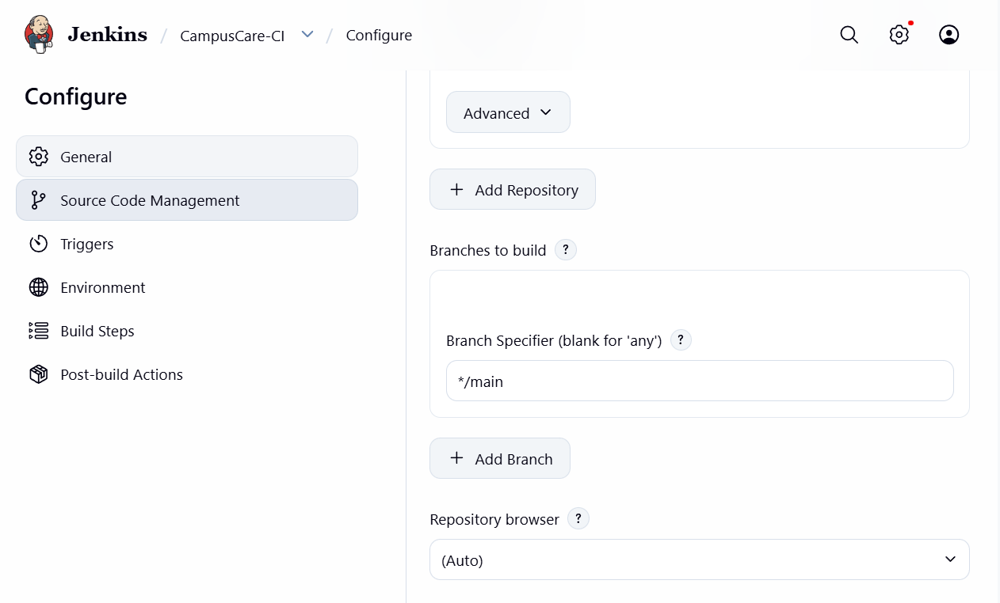

## Screenshot 7.4
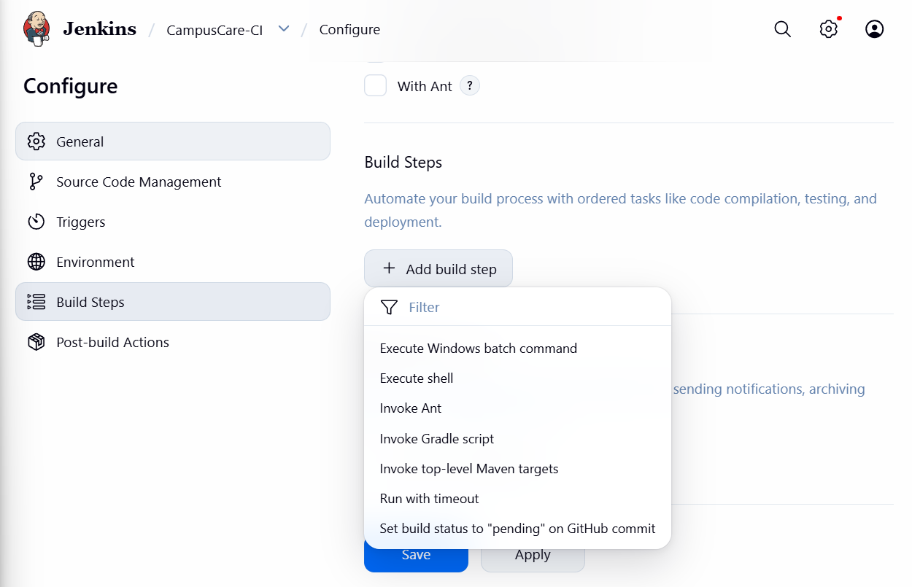

## Screenshot 7.5
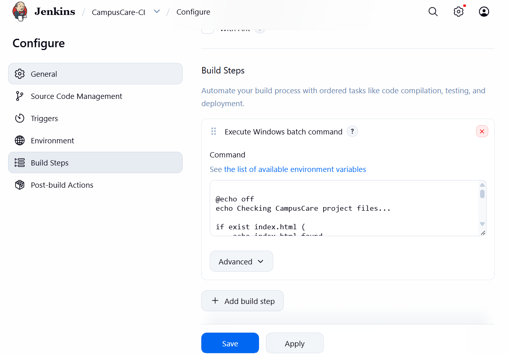

## Screenshot 7.6
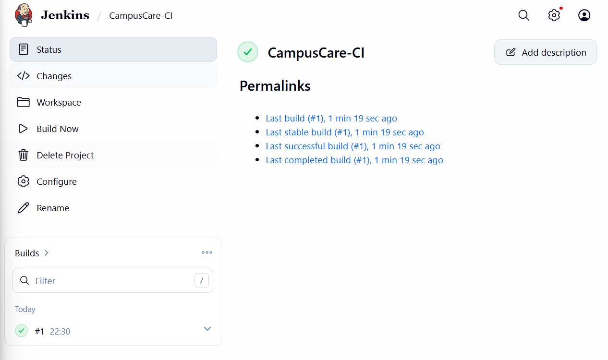

## Screenshot 8.1
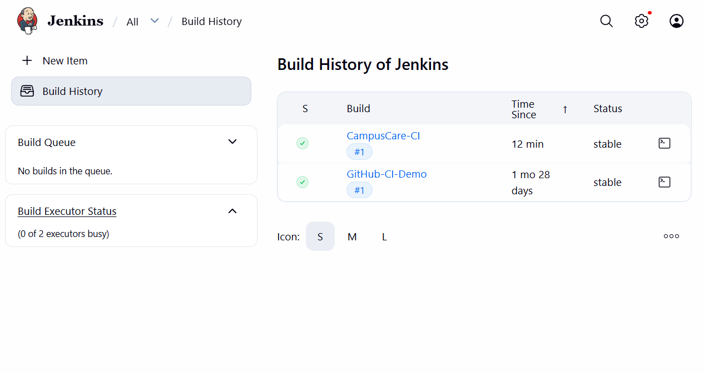

## Screenshot 9.1
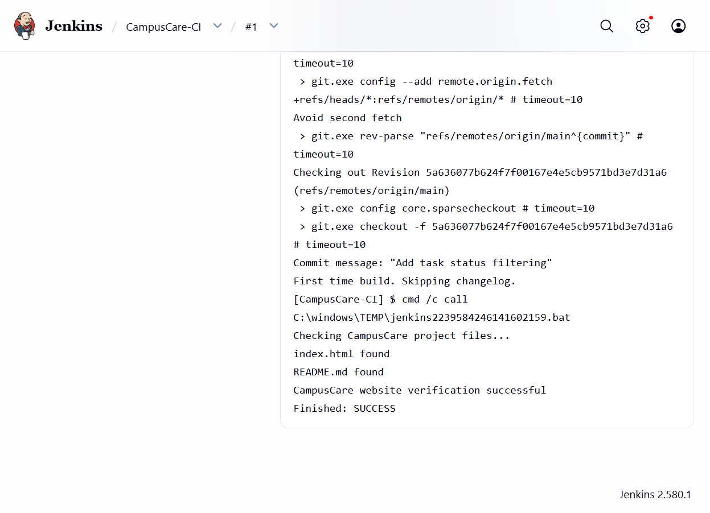

## Screenshot 10.1
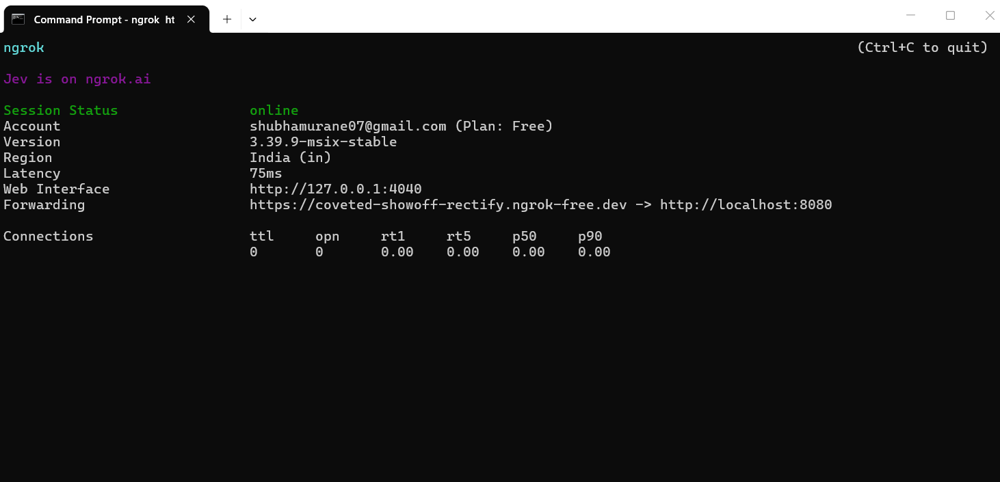

## Screenshot 10.2
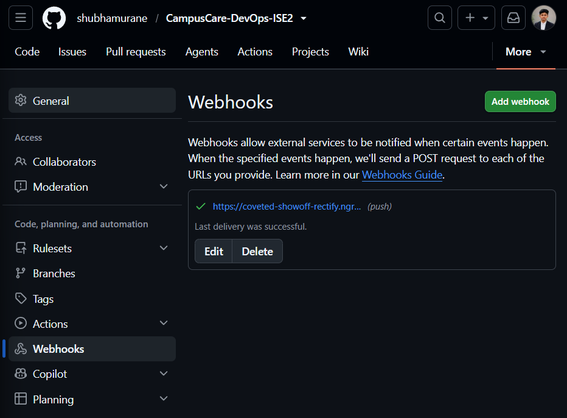

## 10.2

